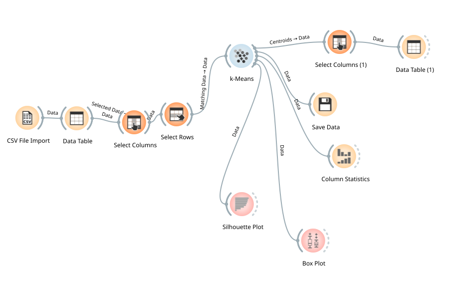

# 🚕 NYC Congestion Relief Charge: Economic Impact & Taxi Zone Clustering

**A before-and-after analysis of New York City's Congestion Relief Zone (CRZ), focusing on driver economics, trip demand, service quality, and targeted fleet interventions.**

This project investigates whether NYC's congestion charge coincided with adverse outcomes for taxi and for-hire vehicle (FHV) operations, particularly in and around Manhattan's charged zone. It combines data preparation, exploratory analysis, statistical hypothesis testing, regression, and K-Means clustering to translate trip-level data into actionable recommendations for fleet operators and policymakers.

> 📌 **Project scope:** The presentation describes approximately **617 million rides** in the broader NYC Taxi & Limousine Commission (TLC) source data for January 2024–December 2025. The analysis uses a **sample extracted from a much larger Microsoft SQL Server database**, because processing the full multi-million-row dataset directly in the notebook was impractical. The repository's sample is not the complete TLC dataset; findings should be interpreted with the sampling design and other limitations in mind.

## 🎯 Business Question

**Does the congestion charge materially affect driver earnings, short-trip demand, trip volume, or service availability—and which NYC taxi zones should receive targeted operational support?**

The analysis considers four dimensions:

- **Driver economics:** Earnings and pay-per-trip/hour before and after the charge.
- **Trip demand:** Daily trip volume and the proportion of short trips (under 2 miles).
- **Service quality:** Rider wait times and shared-ride matching.
- **Geographic disparities:** Zone-level differences and clusters that may benefit from targeted interventions.

## 🗂️ Data and Study Design

- **Source:** Public NYC Taxi & Limousine Commission (TLC) trip records and taxi zone lookup information.
- **Services:** Yellow taxi, green taxi, high-volume for-hire vehicles (FHVHV), and FHV, where relevant fields are available.
- **Source-data coverage described in the presentation:** January 2024–December 2025.
- **Primary pre/post comparisons:** Comparable periods in Q1 2024 and Q1 2025, with January 1–4 excluded in the presented Q1 comparison.
- **Policy:** NYC Congestion Relief Zone charge effective January 5, 2025.
- **Storage and extraction:** Trip data were held in **Microsoft SQL Server**; a smaller analytical sample was extracted for local analysis. The sample follows a stratified, deliberately allocated design described below; population-wide estimates require care because the sample is not simply proportional to trip frequency.
- **Zone clustering:** A derived feature table with **256 active zones** and 10 clustering features.

### 🧪 Sampling Methodology (Microsoft SQL Server Extract)

The original TLC trip dataset contains **over 600 million records**. Even after filtering to the two study windows, the data comprise **tens of millions of trips**, making direct spreadsheet-based hypothesis testing impractical. A smaller analytical dataset was therefore extracted from Microsoft SQL Server using a **stratified sampling design**, rather than a simple random sample.

**1. Define comparable study periods.** Retain January–March 2024 as the **pre-charge** period and January–March 2025 as the **post-charge** period. Comparing the same quarter helps limit seasonal differences. The presentation's primary Q1 comparisons also exclude January 1–4, as noted above.

**2. Screen data quality before sampling.** Exclude records with implausible trip durations, distances or speeds; negative or malformed fares; and pickup locations that cannot be matched to a recognized NYC taxi zone. Sampling is performed on the cleaned eligible records.

**3. Stratify by geography, time, and operator.** Form strata from combinations of:

| Stratification variable | Reason for inclusion |
| --- | --- |
| Pickup taxi zone | Preserve geographic coverage and differences between CRZ and non-CRZ locations |
| Hour band | Represent overnight, AM peak, midday, PM peak, and evening operations |
| Operator group | Include Uber, Lyft, and **Others** (remaining operators combined) |
| Year and month | Include January, February, and March in **both 2024 and 2025** and balance the comparison periods |

**4. Allocate observations deliberately.** Within each operator group, use **equal target allocation across strata** to prevent high-volume zones, hours, or months from dominating the sample. Across operator groups, allocate **80% to Uber and Lyft combined** and reserve **20% for Others**, ensuring smaller operators are represented. Within the Others group, individual operators remain proportionate to their relative size.

**5. Extract the analytical sample.** Use the resulting sampled records for the notebook's descriptive statistics and hypothesis testing; the separate zone-level feature table supports clustering in Orange.

> 💡 **Interpretation note:** This design prioritizes coverage and subgroup comparisons. Equal allocation within strata and the 80/20 operator split do **not** mean the unweighted sample reproduces the population's natural trip frequencies. Population-level totals or averages may require sampling weights; the supplied methodology does not specify weighting or a precise per-stratum sample count. The README therefore does not claim those details.

### 📦 Sample Data

The `data/sample_crz_fixed.zip` archive contains the repository's sampled analytical data. Extract the archive before using the notebook. The notebook currently expects a local file named `sample_crz_fixed.csv`; ensure the extracted CSV is available at the path specified in the notebook (or update `csv_file` accordingly).

⚠️ **Important:** The stratified sample supports analysis across geographic, time, and operator subgroups, but the deliberately balanced allocation does not automatically guarantee unbiased population-level estimates.

## 🔬 Analytical Approach

| Stage | Methods | Purpose |
| --- | --- | --- |
| Data preparation | SQL Server extraction, field standardization, data-quality flags, zone lookup | Create an analysis-ready trip dataset |
| Exploration | Descriptive statistics and visualizations | Compare CRZ and non-CRZ trends |
| Policy impact | Regression with trip and time controls | Separate raw differences from observed trip characteristics |
| Statistical testing | Hypothesis tests, confidence intervals, one-way/two-way ANOVA, Tukey HSD | Assess differences in earnings and service measures |
| Geographic segmentation | K-Means clustering in Orange Data Mining | Identify zones with distinct economic and operational profiles |
| Recommendations | Zone-level interpretation | Prioritize targeted fleet interventions |

### 🧩 K-Means Clustering

The Orange workflow segments **256 active NYC taxi zones** using 10 features: `trips_per_day_25`, `pay_per_hour_25`, `miles_per_trip_25`, `driver_share_25`, `avg_wait_sec_25`, `short_share_25`, `share_to_crz_25`, `peak_share_25`, `trips_growth`, and `pay_per_hour_growth`.

We chose silhouette score for K = 3 is **0.352**; K = 2 scored **0.418**, so the three-cluster solution is a more granular, interpretability-oriented segmentation rather than the highest-silhouette option.

| Cluster | Interpretation | Zones |
| --- | --- | ---: |
| C1 | Outer-borough core: lower driver pay | 154 |
| C2 | Manhattan core: stronger pay and shorter waits | 55 |
| C3 | Lower-density periphery: longer waits | 47 |



## 📊 Selected Findings

*The figures below are reported in the accompanying presentation and should be read in the context of the sampled dataset and study design.*

- **Adjusted per-trip revenue:** The presentation reports an approximately **$0.48 increase per trip** after accounting for observed trip characteristics and controls, versus a **$0.12 decrease** in the raw comparison. This is a model-based association, not proof of a causal policy effect.
- **Driver earnings:** The reported FHVHV comparison does **not find a statistically significant decline** in driver earnings within the CRZ.
- **Fare per mile:** Mean fare per mile increased approximately **3.33%** overall in the presented comparison; the FHVHV segment showed statistically significant growth.
- **Trip demand:** The presentation reports **no statistically significant decline** in daily trip volume or short-trip share in the CRZ comparison.
- **Service quality:** Wait times increased in both charged and control zones, while shared-ride matching did not show a statistically significant deterioration within the CRZ.
- **Targeted intervention:** The cluster analysis suggests focusing on **low-pay C1 zones** and **long-wait C3 zones**, rather than applying a blanket CRZ-wide subsidy.

For definitions, statistical results, visualizations, and caveats, see the [full presentation report](presentation-report/NYC%20Congestion%20Relief%20Charge%20Presentation%20Report.pdf).

## 📁 Repository Structure

```text
.
├── clustering/
│   ├── kmeans_nyc_report.html             # Exported Orange clustering report
│   ├── kmeans_nyc_taxi_zones.ows          # Editable Orange workflow
│   ├── kmeans_nyc_taxi_zones_workflow.svg # Workflow diagram
│   └── zonefeaturetable.csv              # Zone-level clustering features
├── data/
│   └── sample_crz_fixed.zip              # Sample extracted from SQL Server
├── notebooks/
│   └── nyc_crz_analysis.ipynb            # Python statistical analysis
└── presentation-report/
    └── NYC Congestion Relief Charge Presentation Report.pdf
```

## 🧭 How to Explore the Project

1. **Read the presentation** for the problem framing, results, recommendations, and limitations.
2. **Inspect the notebook** at `notebooks/nyc_crz_analysis.ipynb` for data cleaning, visualizations, regression, and statistical tests.
3. **Extract the sample archive** from `data/sample_crz_fixed.zip` and adjust the notebook's CSV path if needed.
4. **Open the clustering workflow** in [Orange Data Mining](https://orangedatamining.com/) using `clustering/kmeans_nyc_taxi_zones.ows`. If its input path does not resolve, reconnect the File widget to `clustering/zonefeaturetable.csv`.
5. **View the exported clustering results** in `clustering/kmeans_nyc_report.html` and the workflow diagram above.

## 💻 Running the Notebook

### 🖥️ Option 1: Run Locally with Jupyter Notebook

Launch the notebook from the project root directory:

```bash
jupyter notebook notebooks/nyc_crz_analysis.ipynb
```

The notebook will open in your default web browser, where you can execute cells and explore the analysis interactively.

### ☁️ Option 2: Run in Google Colab

You may also run the notebook in Google Colab without installing Jupyter locally.

1. Open Google Colab: https://colab.research.google.com
2. Select **File → Upload Notebook**
3. Upload `notebooks/nyc_crz_analysis.ipynb`
4. Install any missing dependencies in a notebook cell if required:

```python
!pip install pandas numpy matplotlib scipy statsmodels sqlalchemy pyodbc
```

## ⚠️ Limitations

- The released dataset is a **sample**, not the complete TLC trip population. Equal allocation across strata and the deliberate operator-group split may require weighting for population-level inference; sampling and selection effects affect external validity.
- **Observational Study Limitations:** To minimise seasonal confounding, the analysis compares the same calendar period (January–March) in 2024 and 2025, ensuring a consistent seasonal baseline. However, other contemporaneous factors, such as changes in passenger demand, fuel costs, and ride-hailing platform behaviour, may still influence the observed outcomes. Regression controls help account for some of these factors, but the observational design does not establish definitive causality.
- Not all TLC service types provide the same driver-pay or wait-time fields; comparisons depend on data availability and metric definitions.
- Zone-level clusters are descriptive operational segments, not causal evidence of the congestion charge's impact.
- The presentation identifies opportunities to improve measurement of actual in-zone distance, declined offers, abandoned requests, driver identifiers, and idle/cruising time.

## 📚 References and Acknowledgements

- [NYC Taxi & Limousine Commission — Trip Record Data](https://www.nyc.gov/site/tlc/about/tlc-trip-record-data.page)
- [Orange Data Mining](https://orangedatamining.com/)
- The presentation discloses the use of AI tools for illustrative imagery and writing assistance, with outputs reviewed and adapted by the project author.

**Project:** *Protecting the Fleet: Ground-Truth Economics Under NYC's Congestion Relief Charge*.


---

## 👩‍💻 Author

**Jennifer P. Sing**  
Data analytics project — NYC Congestion Relief Charge: Economic Impact & Taxi Zone Clustering

📧 **Email:** [sing.jenniferp@gmail.com](mailto:sing.jenniferp@gmail.com)

*This repository documents the analytical workflow, findings, and supporting materials for the project.*
